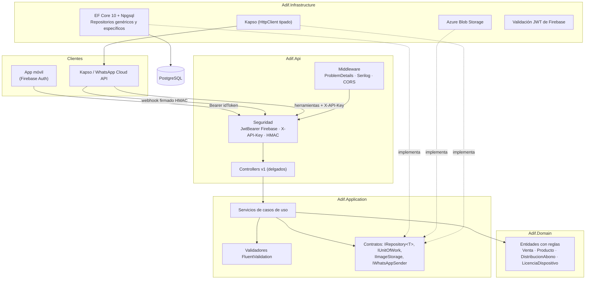
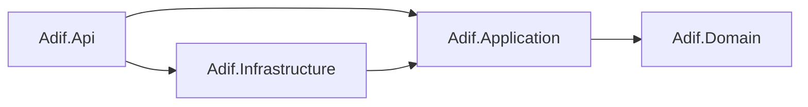
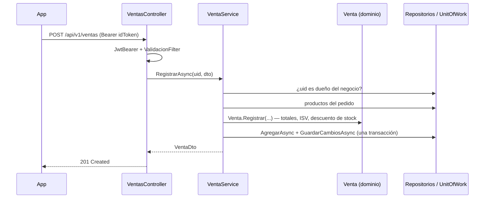

# ADIF Lite API

[](https://github.com/Mine25-afk/adif-lite-api/actions/workflows/ci.yml)
[](https://github.com/Mine25-afk/adif-lite-api/actions/workflows/docker.yml)


[](LICENSE)

Backend **SaaS multi-tenant** para pulperías (tiendas de barrio de Centroamérica). Cada pulpería es un
*tenant* que maneja su **inventario**, registra **ventas de contado y a crédito**, lleva el **fiado**
(cuentas por cobrar de sus clientes) y lo opera también desde **WhatsApp** con un bot de botones y listas.
La app móvil se autentica con **Google/Firebase** y paga una **licencia mensual** por dispositivo.

> Proyecto de portafolio. El código nace de un producto real y se reescribió con Clean Architecture,
> pruebas automatizadas y prácticas de seguridad; no contiene credenciales ni datos de clientes.

---

## Contenido

- [Funcionalidades](#funcionalidades)
- [Arquitectura](#arquitectura)
- [Stack](#stack)
- [Decisiones de diseño](#decisiones-de-diseño)
- [Seguridad](#seguridad)
- [Cómo correrlo](#cómo-correrlo)
- [Configuración](#configuración)
- [Endpoints principales](#endpoints-principales)
- [Pruebas](#pruebas)
- [CI/CD](#cicd)
- [Limitaciones conocidas y siguientes pasos](#limitaciones-conocidas-y-siguientes-pasos)
- [Autores y licencia](#autores-y-licencia)

## Funcionalidades

| Módulo | Qué hace |
|---|---|
| **Negocios** | Alta de la pulpería con su número de WhatsApp Business y el operador inicial. Un usuario solo ve y opera sus negocios. |
| **Inventario** | CRUD de productos paginado y con búsqueda, código de barras único por negocio, precio de mayoreo, ajustes de stock, alerta de stock bajo e imágenes en Azure Blob (URL firmada de 2 h). |
| **Ventas** | Venta de contado o a crédito con ISV del 15 %, descuento de inventario atómico y anulación que repone el stock. |
| **Fiado** | Cargos y abonos; el abono se reparte **FIFO** entre los créditos abiertos del cliente. Lista de deudores. |
| **Bot de WhatsApp** | Máquina de estados **sin IA** (botones y listas) para anotar créditos, registrar abonos, consultar saldos y dar de alta clientes. Multi-cuenta Kapso: cada negocio firma y envía con sus propias credenciales. |
| **Licencias** | Bitácora de accesos por dispositivo, compra de meses (el vencimiento lo calcula el servidor), bloqueo de dispositivos y códigos de activación de un solo uso. |

El modelo de datos incluye además **compras, caja, gastos y agenda**, listos para exponerse (ver *siguientes pasos*).

## Arquitectura

Clean Architecture en cuatro proyectos. Las dependencias apuntan **hacia adentro**: el dominio no conoce
a nadie y la infraestructura implementa los contratos que define la aplicación.





### Flujo de una venta



### Estructura

```text
adif-lite-api/
├── src/
│   ├── Adif.Domain/           Entidades por dominio (Inventario, Ventas, Fiado, WhatsApp, Licencias…) y sus reglas
│   ├── Adif.Application/      Servicios (casos de uso), DTOs, validadores, contratos de persistencia y servicios externos
│   ├── Adif.Infrastructure/   DbContext, migraciones, repositorios, Azure Blob, Kapso, autenticación Firebase
│   └── Adif.Api/              Controllers v1, middleware de errores, filtros, seguridad y Program.cs
├── tests/
│   ├── Adif.UnitTests/        Dominio, servicios (NSubstitute), validadores e infraestructura en memoria
│   └── Adif.IntegrationTests/ API completa con WebApplicationFactory + EF InMemory
├── .github/workflows/         ci.yml (build, test, cobertura) y docker.yml (imagen)
├── Dockerfile · docker-compose.yml · .env.example
└── Directory.Build.props · Directory.Packages.props (versiones centralizadas)
```

## Stack

| Capa | Tecnología |
|---|---|
| Runtime | .NET 10, ASP.NET Core (controllers) |
| Persistencia | EF Core 10 + Npgsql (PostgreSQL 16), migraciones de EF |
| Validación | FluentValidation 12 (mensajes en español) |
| Autenticación | `AddJwtBearer` validando el idToken de Firebase contra los JWKS de Google |
| Integraciones | Kapso (proxy del WhatsApp Cloud API), Azure Blob Storage |
| Observabilidad | Serilog a consola (JSON compacto fuera de Development), `/healthz` con chequeo de la base |
| Documentación | Swagger / OpenAPI (solo en Development) |
| Pruebas | xUnit, NSubstitute, FluentAssertions, `Microsoft.AspNetCore.Mvc.Testing`, EF InMemory, coverlet |
| DevOps | Docker multi-stage sin root, docker-compose, GitHub Actions |

## Decisiones de diseño

| Decisión | Por qué |
|---|---|
| **Clean Architecture (4 proyectos)** | Las reglas de negocio (totales, ISV, FIFO de abonos, stock) viven en el dominio y se prueban sin base ni HTTP. Cambiar PostgreSQL, Kapso o Blob solo toca Infrastructure. |
| **Dominio rico** | `Venta.Registrar`, `Producto.DescontarStock`, `DistribucionAbono.Aplicar`: la entidad protege sus invariantes; el servicio solo orquesta. |
| **Repository genérico + específicos** | `IRepository<T>` cubre CRUD, existencia, conteo y **paginación** (`PagedResult<T>`); los repositorios específicos encapsulan consultas con intención (`ListarCreditosAbiertosAsync`, saldos por subconsulta para evitar N+1). La aplicación nunca ve `IQueryable` ni EF. |
| **Unit of Work** | Venta, renglones y stock se confirman en un solo `SaveChanges`, que EF envuelve en una transacción. |
| **DI por interfaces** | Cada servicio y adaptador se registra por su interfaz; las pruebas sustituyen cualquier pieza con NSubstitute. |
| **Controllers delgados** | Reciben, delegan y devuelven. El uid sale **siempre del token** (`ApiControllerBase.Uid`), nunca del body. |
| **Validación en el borde** | Un filtro global ejecuta el `IValidator<T>` de cada argumento y responde `400` con `ValidationProblemDetails`; el dominio sigue validando sus invariantes por si el caso de uso llega desde el bot. |
| **Errores como ProblemDetails (RFC 9457)** | `IExceptionHandler` traduce `NotFound → 404`, `Forbidden → 403`, `Conflict → 409`, `DomainException → 422` y el resto a `500` sin filtrar detalles internos; cada respuesta lleva `traceId`. |
| **Mapeo con atributos** | Tablas, columnas, claves, índices y relaciones se declaran en la entidad; Fluent API solo para `DeleteBehavior`, tokens de concurrencia y la convención de `DEFAULT` en columnas. |
| **Sin `NULL` en la base** | Toda columna de texto o número lleva `DEFAULT`; las fechas "no ocurridas" usan `1900-01-01`. |
| **Versionado en la URL (`/api/v1`)** | Rutas fijas sin parámetros de plantilla: los datos van por query string o body. Una v2 convive con controllers propios. |
| **`TimeProvider` inyectado** | Las fechas (vencimientos, licencias, expiración de sesiones) son deterministas en las pruebas. |
| **Versiones centralizadas** | `Directory.Packages.props` (CPM) y `TreatWarningsAsErrors` en todos los proyectos. |
| **FluentAssertions 7** | Última versión con licencia Apache 2.0 (la 8 cambió a licencia comercial). |

## Seguridad

- **Autenticación estándar**: `AddAuthentication().AddJwtBearer()` con emisor `https://securetoken.google.com/{projectId}`,
  audiencia `{projectId}`, vigencia y firma contra los JWKS de Google; se rechaza un token sin `sub`.
  Sin `service-account.json`: validar un idToken no necesita credenciales.
- **Seguro por defecto**: política *fallback* que exige usuario autenticado en **todo** endpoint; solo `/healthz`,
  el webhook y las herramientas de fiado declaran `[AllowAnonymous]` y tienen su propio mecanismo.
- **Aislamiento multi-tenant**: cada caso de uso verifica que el uid sea dueño del `negocioId` (`403` si no).
- **Herramientas de Kapso** (`/api/v1/fiado/*`): `X-API-Key` comparada en tiempo constante. Si la clave no está
  configurada se **rechaza todo** (falla cerrado).
- **Webhook**: firma **HMAC-SHA256** por número (cada negocio tiene su secreto, mínimo 16 caracteres), cuerpo crudo,
  comparación en tiempo constante, deduplicación de reintentos y respuesta `200` ante errores internos para que
  Kapso no repita operaciones.
- **Licencias**: el servidor calcula el vencimiento; el cliente solo indica cuántos meses (1–12).
- **Archivos**: imágenes JPEG/PNG/WebP de hasta 5 MB, extensión derivada del Content-Type, contenedor privado y URLs SAS temporales.
- **Configuración**: secretos solo por variables de entorno o *user-secrets*; CORS por lista de orígenes; Swagger solo en Development;
  migraciones automáticas únicamente si `Database:AplicarMigracionesAlIniciar=true`.
- **Contenedor**: imagen multi-stage que corre como el usuario sin privilegios `APP_UID`.

## Cómo correrlo

### Con Docker (API + PostgreSQL)

```bash
cp .env.example .env        # completa POSTGRES_PASSWORD y FIREBASE_PROJECT_ID
docker compose up --build
```

- API: <http://localhost:8080> · Swagger: <http://localhost:8080/swagger> · Salud: <http://localhost:8080/healthz>
- PostgreSQL queda en `127.0.0.1:5433`. Las migraciones se aplican al arrancar (`Database__AplicarMigracionesAlIniciar=true`).

### Local con el SDK

Requisitos: .NET SDK 10 y un PostgreSQL accesible.

```bash
cd src/Adif.Api
dotnet user-secrets set "ConnectionStrings:Postgres" "Host=localhost;Port=5433;Database=adif_lite;Username=adif;Password=<tu-clave>"
dotnet user-secrets set "Firebase:ProjectId" "<tu-proyecto-firebase>"
dotnet run
```

En Development las migraciones se aplican solas. Para aplicarlas a mano o crear nuevas:

```bash
dotnet tool restore
export ADIF_DESIGN_CONNECTION="Host=localhost;Port=5433;Database=adif_lite;Username=adif"
export PGPASSWORD="<tu-clave>"          # Npgsql la toma del entorno
dotnet ef database update --project src/Adif.Infrastructure
dotnet ef migrations add <Nombre> --project src/Adif.Infrastructure --output-dir Persistence/Migrations
```

### Obtener un token para probar

La API acepta el **idToken** que entrega Firebase Auth al iniciar sesión en la app
(`await user.getIdToken()` en el SDK web/móvil). En Swagger se pega en **Authorize**.

## Configuración

| Clave (`appsettings` / variable de entorno) | Uso | Por defecto |
|---|---|---|
| `ConnectionStrings:Postgres` / `ConnectionStrings__Postgres` | Cadena de PostgreSQL (la contraseña puede ir en `PGPASSWORD`) | vacío |
| `Firebase:ProjectId` / `Firebase__ProjectId` | Proyecto cuyos idToken se aceptan. **Obligatorio**: sin él la API no arranca | vacío |
| `Kapso:ToolsApiKey` | Clave de `X-API-Key` para `/api/v1/fiado/*` (vacía = rechaza todo) | vacío |
| `Kapso:ProjectApiKey` | API key global de Kapso si el número no trae la suya (vacía = envíos simulados) | vacío |
| `Kapso:BaseUrl` | URL del proxy de WhatsApp | `https://api.kapso.ai/meta/whatsapp/v24.0` |
| `ConnectionStrings:Blob`, `Blob:Container` | Azure Blob para imágenes | vacío, `productos` |
| `Cors:OrigenesPermitidos` | Orígenes del navegador permitidos | ninguno (Development: `localhost:4200`, `localhost:8100`) |
| `Database:AplicarMigracionesAlIniciar` | Aplica migraciones al arrancar | `false` (Development: `true`) |
| `ReverseProxy:Habilitado` | Confía en `X-Forwarded-For/Proto` de un proxy | `false` |
| `Serilog:MinimumLevel` | Niveles de log | `Information` |

## Endpoints principales

Todos bajo `/api/v1`. Salvo que se indique, requieren `Authorization: Bearer <idToken>`.
Errores en `application/problem+json`.

| Método | Ruta | Descripción |
|---|---|---|
| `POST` | `/negocios` | Crea la pulpería con su número de WhatsApp y operador inicial |
| `GET` | `/negocios/mios` | Negocios del usuario autenticado |
| `POST` | `/negocios/operadores` | Autoriza un teléfono a operar el fiado por WhatsApp |
| `GET` | `/productos?negocioId=&buscar=&pagina=&tamano=` | Inventario paginado con búsqueda |
| `GET` | `/productos/detalle?negocioId=&id=` | Detalle de un producto |
| `POST` / `PUT` | `/productos` · `/productos?id=` | Alta y edición |
| `POST` | `/productos/ajuste-stock` | Ajuste manual de inventario con motivo |
| `GET` | `/productos/stock-bajo?negocioId=` | Productos bajo su mínimo |
| `POST` / `GET` | `/productos/imagen?negocioId=&productoId=` | Sube imagen (multipart `archivo`) / obtiene URL firmada |
| `POST` | `/ventas` | Registra una venta (contado o crédito, ISV opcional) |
| `GET` | `/ventas?negocioId=&desde=&hasta=&pagina=&tamano=` | Ventas paginadas |
| `GET` | `/ventas/detalle?negocioId=&id=` | Venta con sus renglones |
| `POST` | `/ventas/anular?negocioId=&id=` | Anula y repone el stock |
| `POST` | `/licencias/accesos` | Registra el acceso de un dispositivo |
| `GET` / `POST` | `/licencias/dispositivos` | Lista / da de alta dispositivos del usuario |
| `PUT` | `/licencias/dispositivos/bloqueo` | Bloquea o desbloquea un dispositivo propio |
| `POST` | `/licencias/mensualidades` | Compra meses de licencia |
| `POST` | `/licencias/codigos/canjear` | Canjea un código de activación |
| `POST` / `GET` | `/fiado/clientes` · `/fiado/clientes/buscar` · `/fiado/clientes/saldo` | Herramientas del agente (**`X-API-Key`**) |
| `POST` | `/fiado/cargos` · `/fiado/abonos` | Anotar crédito / registrar abono (**`X-API-Key`**) |
| `GET` | `/fiado/deudores` | Deudores del negocio (**`X-API-Key`**) |
| `POST` | `/whatsapp/webhook` | Webhook de Kapso (**firma HMAC** en `X-Webhook-Signature`) |
| `GET` | `/healthz` | Salud de la API y la base (público, fuera de `/api/v1`) |

Ejemplo de venta:

```http
POST /api/v1/ventas
Authorization: Bearer <idToken>
Content-Type: application/json

{
  "negocioId": 1,
  "socioId": 0,
  "esCredito": false,
  "aplicaIsv": true,
  "metodo": "Efectivo",
  "lineas": [ { "productoId": 10, "cantidad": 2 } ]
}
```

## Pruebas

```bash
dotnet test Adif.slnx
# con cobertura (excluye migraciones):
dotnet test Adif.slnx --settings coverlet.runsettings --collect "XPlat Code Coverage"
```

| Proyecto | Qué cubre |
|---|---|
| `Adif.UnitTests` (114 casos) | Reglas del dominio (stock, totales e ISV, anulación, FIFO de abonos, licencias), servicios de ventas, fiado, inventario y licencias con dependencias simuladas, bot de WhatsApp (máquina de estados), parser y firma del webhook, validadores e infraestructura en memoria |
| `Adif.IntegrationTests` (18 casos) | La API completa con `WebApplicationFactory` y EF InMemory: `401` sin token con el JwtBearer real, `/healthz`, Swagger oculto fuera de Development y generado en Development, inventario y ventas de punta a punta, `403` entre tenants, `400`/`422` como ProblemDetails, API key de herramientas (incluido el rechazo con clave vacía) y webhook firmado vs. falsificado |

No necesitan Docker ni PostgreSQL.

## CI/CD

- **`ci.yml`**: restore → build en Release con warnings como errores → pruebas con cobertura → resumen de cobertura en el job y artefactos (HTML + resultados `.trx`).
- **`docker.yml`**: construye la imagen con Buildx y caché de GitHub Actions cuando cambian `src/`, el `Dockerfile` o las versiones de paquetes, y verifica que no corra como root. No publica en ningún registro.

## Limitaciones conocidas y siguientes pasos

- **Concurrencia de stock**: dos ventas simultáneas del mismo producto podrían sobrevender; el siguiente paso es un token de concurrencia (`xmin` de PostgreSQL) en `productos`.
- **Estado del bot en memoria**: sesiones y deduplicación viven en el proceso; con varias réplicas deben ir a Redis.
- **Credenciales de Kapso por negocio** (`webhook_secret`, `kapso_api_key`) se guardan en la base sin cifrar; lo correcto es cifrarlas o moverlas a un gestor de secretos.
- **Compra de mensualidad** no verifica un pago: en producción debería dispararla el webhook de la pasarela.
- **Compras, caja, gastos y agenda** ya tienen modelo y migración, pero aún no endpoints.

## Autores y licencia

Desarrollado por **Eduardo Varela** y **Alejandra Solis**. Distribuido bajo la [licencia MIT](LICENSE).
